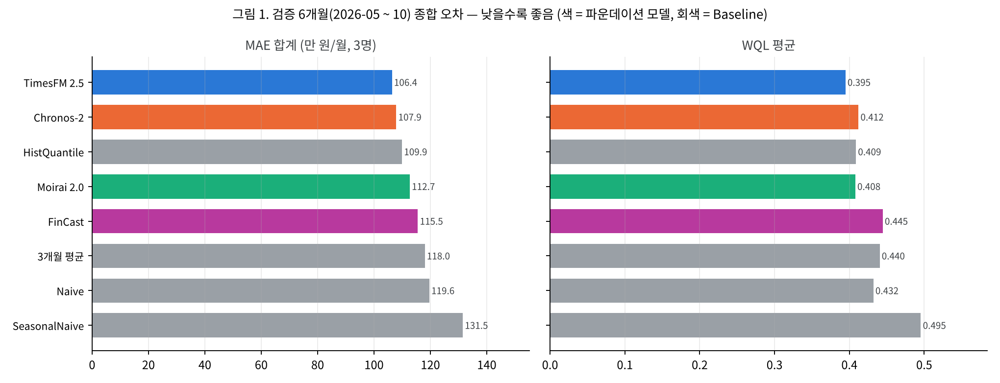
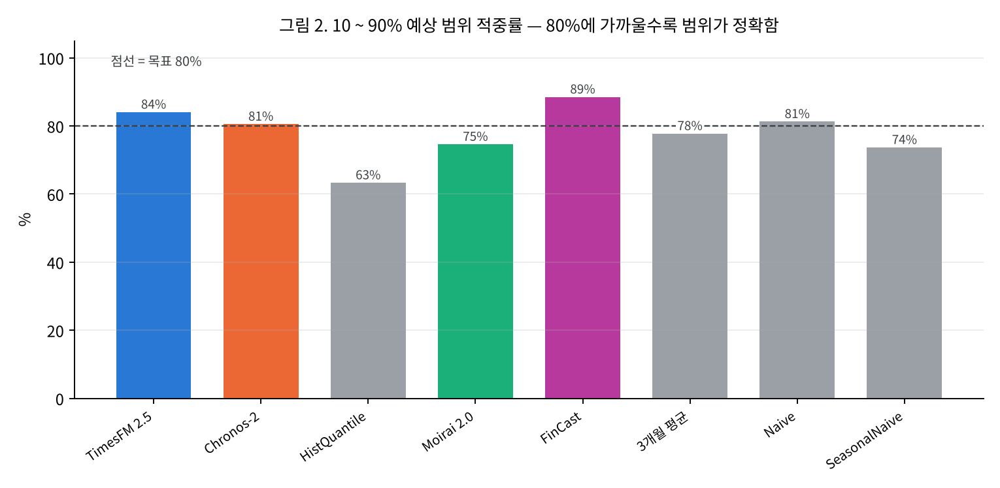
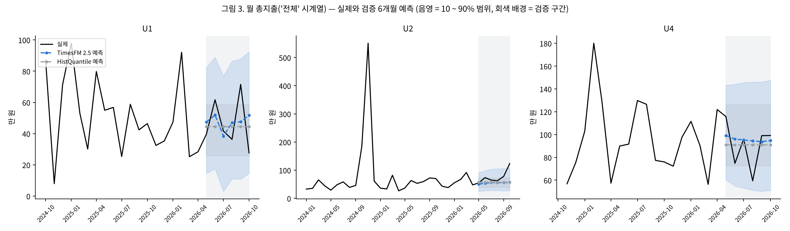

# SpendRadar 팀원 지출 데이터 — 시계열 파운데이션 모델 평가

SpendRadar(가천대 AI P-실무프로젝트) 지출 예측에 쓸 모델을 **팀원의 실제 지출**로 검증하는 **시계열 파운데이션 모델 4종 zero-shot 평가** 코드·결과.
사용자별 카테고리 6개 + 전체(월 총지출)의 마지막 6개월(2026-05 ~ 2026-10)을 **직접 방식**(입력 기간 전체를 보고 6개월을 한 번에 예측)으로 예측하고 MAE·MASE·WQL을 Baseline 4종과 비교함. 같은 방식으로 향후 6개월(2026-11 ~ 2027-04)도 예측함.

**결론: TimesFM 2.5가 종합 MAE · WQL 1위지만 HistQuantile과의 차이(MAE 3.2%)는 통계적으로 유의하지 않음(p = 0.14).** 팀원 데이터는 TabFormer 평가의 TimesFM 2.5 선정과 모순되지 않지만, 이 데이터만으로 "확실히 더 좋다"고 말할 수는 없음.

- 데이터셋·Baseline: [spendRadar-TeamData-Baseline](https://github.com/spendRadar/spendRadar-TeamData-Baseline) (전처리·포함 조건·Baseline 상세)
- TabFormer 합성 데이터 평가: [spendRadar-Dataset-FM](https://github.com/spendRadar/spendRadar-Dataset-FM) — 이 레포는 그 README의 "팀원 가계부로 추가 검증"에 해당함
- 두 레포(TeamData-Baseline · TeamData-FM)는 같은 데이터(`data/team_monthly_long.csv`)와 같은 계산 코드(`src/spendradar_team.py`)를 사용함

## 1. 평가 모델
| 모델 | 체크포인트 | 가중치 라이선스 | 노트북 |
|---|---|---|---|
| TimesFM 2.5 (Google) | google/timesfm-2.5-200m-pytorch | Apache-2.0 | `notebooks/run_timesfm_colab.ipynb` |
| Chronos-2 (Amazon) | amazon/chronos-2 | Apache-2.0 | `notebooks/run_chronos_colab.ipynb` |
| Moirai 2.0 (Salesforce) | Salesforce/moirai-2.0-R-small | CC BY-NC 4.0 (비상업) | `notebooks/run_moirai_colab.ipynb` |
| FinCast (CIKM 2025) | Vincent05R/FinCast (v1.pth, 약 4GB) | Apache-2.0 | `notebooks/run_fincast_colab.ipynb` |

- 모두 추가 학습 없이(zero-shot) 시계열마다 6개월을 한 번에 예측, 분위수 0.1 ~ 0.9 출력
- 전 기간 0원인 시계열은 0원 예측, 음수는 0으로 자르고 분위수는 크기순 정렬
- 입력 길이: 검증 18 ~ 28개월 / 향후 예측 24 ~ 34개월
- Baseline 4종(HistQuantile · Naive · SeasonalNaive · 3개월 평균)도 같은 직접 방식 ([Baseline 레포](https://github.com/spendRadar/spendRadar-TeamData-Baseline) 2장)

## 2. 데이터
- 팀원 3명(익명 ID U1 · U2 · U4) × 시계열 7개(식비 / 카페, 주거 / 통신, 쇼핑 / 패션, 교통 / 차량, 문화 / 여가, 의료 + 전체), 월 지출(원)
- 카드 결제(소비)만 사용, 송금 · 이체 · '기타' 제외. U3는 기록 누락으로 포함 조건(기록 기간 18개월 이상) 미달 → 제외
- 검증(test) 2026-05 ~ 2026-10, 평가 시계열 17개 (카테고리 6개 × 3명 중 전 기간 0원인 U1 주거 / 통신 제외)
- 원본 엑셀은 개인 금융 정보라 올리지 않음. 전처리 규칙 · 사용자 포함 여부는 [Baseline 레포](https://github.com/spendRadar/spendRadar-TeamData-Baseline) README

## 3. 결과
### 종합 (검증 2026-05 ~ 2026-10, 3명, 낮을수록 좋음) — `results/comparison_overall.csv`
| 순위 | 모델 | 구분 | MAE 합계 (원/월) | MASE 평균 | WQL 평균 | 10 ~ 90% 범위 적중률 |
|---|---|---|---|---|---|---|
| 1 | TimesFM 2.5 | 파운데이션 | 1,063,737 | 0.892 | **0.395** | 84% |
| 2 | Chronos-2 | 파운데이션 | 1,078,826 | 0.877 | 0.412 | 81% |
| 3 | HistQuantile | Baseline | 1,099,234 | 0.894 | 0.409 | 63% |
| 4 | Moirai 2.0 | 파운데이션 | 1,126,824 | 0.934 | 0.408 | 75% |
| 5 | FinCast | 파운데이션 | 1,155,447 | 0.819 | 0.445 | 89% |
| 6 | 3개월 평균 | Baseline | 1,180,189 | 0.912 | 0.440 | 78% |
| 7 | Naive | Baseline | 1,196,130 | **0.797** | 0.432 | 81% |
| 8 | SeasonalNaive | Baseline | 1,314,950 | 1.210 | 0.495 | 74% |




### 파운데이션 모델 vs Baseline (시계열 17개의 MASE, Wilcoxon 단측 검정) — `results/comparison_tests.csv`
| 파운데이션 모델 | vs HistQuantile | vs Naive | vs 3개월 평균 | vs SeasonalNaive |
|---|---|---|---|---|
| TimesFM 2.5 | 11승 6패, p = 0.142 | 8승 9패, p = 0.445 | 10승 7패, p = 0.274 | 11승 6패, p = 0.013 |
| Chronos-2 | 10승 7패, p = 0.153 | 6승 11패, p = 0.726 | 10승 7패, p = 0.229 | 11승 6패, p = 0.028 |
| Moirai 2.0 | 8승 9패, p = 0.785 | 8승 9패, p = 0.644 | 6승 11패, p = 0.811 | 11승 6패, p = 0.049 |
| FinCast | 6승 9패, p = 0.633 | 7승 7패, p = 0.681 | 7승 9패, p = 0.582 | 11승 6패, p = 0.103 |

- p < 0.05는 SeasonalNaive 대비 3개뿐이고, 검정 16개를 함께 보정(Bonferroni, 0.05 / 16 ≈ 0.003)하면 유의한 차이는 없음
- 무승부(값이 같은 시계열)는 승패에서 빠짐

### 해석
- **TimesFM 2.5**: MAE 합계 · WQL 평균 1위, 범위 적중률 84%로 목표(80%)에 가까움. 다만 2위 Chronos-2와 MAE 1.4%, 3위 HistQuantile과 3.2% 차이로 근소하고 유의하지 않음
- **사용자별 1위는 제각각**: MAE 기준 U1은 HistQuantile, U2는 Naive, U4는 Chronos-2 (`comparison_by_user.csv`). 시계열 17개의 MASE 1위도 8개 모델에 흩어짐(TimesFM 2.5는 2개, `comparison_by_series.csv`)
- **Chronos-2**: TimesFM 2.5와 거의 같은 수준. 월 총지출('전체') MAE는 TimesFM 2.5보다 낮음(15.4만 vs 16.2만 원/월)
- **Moirai 2.0**: TabFormer에서는 공동 1위였지만 여기서는 HistQuantile보다 MAE가 높음. U2 주거 / 통신을 크게 과대 예측(MASE 1.22)
- **FinCast**: 범위 적중률은 가장 높지만(89%) 범위를 넓게 잡은 결과(U2 '전체' 하한 0원 등)이고 WQL은 파운데이션 모델 중 가장 나쁨
- **HistQuantile**: 범위 적중률이 63%로 낮음 — 최근 12개월 분위수만 쓰므로 범위가 좁음
- **MASE 평균은 Naive가 1위**: MASE 분모가 '지난달 값' 예측이라 Naive에 유리하고, 0원이 많은 '의료' 시계열 영향을 받음 → 금액 기준 판단은 MAE · WQL로 함

### TabFormer 평가와 비교
| | TabFormer (합성 데이터) | 팀원 데이터 (이 레포) |
|---|---|---|
| 1위 | Moirai 2.0 · TimesFM 2.5 공동 | TimesFM 2.5 (MAE · WQL) |
| Chronos-2 | 3위, 상위와 차이 작음 | 2위, TimesFM 2.5와 차이 작음 |
| HistQuantile | 최고 Baseline, 상위 3개보다 나쁨 | 최고 Baseline, TimesFM 2.5 · Chronos-2보다 나쁨(유의하지 않음) |
| FinCast | HistQuantile보다 나쁨 | HistQuantile보다 나쁨 |
| Moirai 2.0 | 공동 1위 | HistQuantile보다 나쁨 |

→ TimesFM 2.5 선정과 같은 방향의 결과. 다만 표본이 작아(3명 · 시계열 17개 · 검증 1회) 근거는 약함

### 향후 6개월 예측 (2026-11 ~ 2027-04, '전체' 시계열 합계, 원) — `results/comparison_forecast_total.csv`
| 모델 | U1 | U2 | U4 |
|---|---|---|---|
| TimesFM 2.5 | 2,706,656 | 4,157,274 | 5,465,633 |
| Chronos-2 | 2,644,600 | 4,262,288 | 5,439,408 |
| HistQuantile | 2,279,970 | 3,818,376 | 5,812,506 |
| Moirai 2.0 | 2,572,261 | 4,766,616 | 6,073,547 |
| FinCast | 1,844,316 | 9,349,477 | 5,735,958 |

- U2는 모델마다 차이가 큼: 마지막 달(2026-10) 지출이 124만 원으로 평소보다 높아 FinCast · Naive는 높게, HistQuantile은 낮게 예측
- 실제 검증 구간 6개월 합계: U1 278만 · U2 457만 · U4 545만 원



### 지표
| 지표 | 정의 | 단위 |
|---|---|---|
| MAE | 실제 월 지출과 예측 중앙값(q0.5)의 평균 절대 차이 | 원/월 |
| MASE | MAE ÷ 입력 구간에서 '지난달 값' 예측(lag 1)의 평균 오차. 1 미만이면 그보다 정확 | 없음 |
| WQL | 분위수 0.1 ~ 0.9 예측의 가중 분위수 손실 (2 × Σpinball ÷ Σ\|실제\|, 분위수 평균) | 없음 |

- 사용자 종합 = 카테고리 6개 기준 (MAE는 카테고리 합, MASE · 적중률은 카테고리 평균, WQL은 카테고리를 합쳐서 계산), 3명 값은 MAE 합계 · MASE · WQL 평균
- TabFormer 레포는 MASE 분모로 '작년 같은 달'(m = 12)을 쓰지만, 이 데이터는 입력이 18 ~ 28개월뿐이라 '지난달'(lag 1)을 씀 → 두 레포의 MASE 값은 직접 비교하지 않음

## 4. 폴더 구조
```
data/
  team_monthly_long.csv        3명 × 시계열 7개 월 지출 (Baseline 레포와 동일)
src/
  spendradar_team.py           데이터 로드, 직접 예측, 지표 계산 (Baseline 레포와 공통, 노트북 3 ~ 5번 셀과 같은 계산)
notebooks/
  run_<모델>_colab.ipynb       모델별 Colab 실행 (timesfm · chronos · moirai · fincast), 사람별 표 4개 · 그래프 3개
scripts/
  1_compare.py                 8개 모델 비교 → results/comparison_*.csv
  2_charts.py                  비교 그림 → report/figures/
  3_build_results_xlsx.py      결과 엑셀 → results/SpendRadar_TeamData_results.xlsx
report/figures/                 그림 1 ~ 3 (3장)
results/
  <모델>/ALL_metrics_<모델>.csv      사용자 × 시계열 지표 (카테고리 '종합' = 카테고리 6개 기준 사용자 종합)
  <모델>/ALL_forecast_<모델>.csv     향후 6개월 예측 (중앙값 · 10% · 90%)
  <모델>/ALL_validation_<모델>.csv   검증 구간 실제 vs 예측
  <모델>/ENV_<모델>.csv              실행 환경 · 패키지 버전
  baseline/                         Baseline 레포 results/의 복사본 (비교용)
  comparison_*.csv · SpendRadar_TeamData_results.xlsx   (1 ~ 3단계 결과)
```

## 5. 실행 방법
**파운데이션 모델 (Colab T4 GPU)**: `notebooks/run_<모델>_colab.ipynb`를 Colab에서 열고 셀을 하나씩 실행 (GitHub에서 바로 열기: `https://colab.research.google.com/github/spendRadar/spendRadar-TeamData-FM/blob/main/notebooks/run_timesfm_colab.ipynb`). 2번 셀이 이 레포의 `data/team_monthly_long.csv`를 받음. 마지막 셀이 내려받는 CSV 4개(`ALL_*_<모델>.csv` 3개 + `ENV_<모델>.csv`)를 `results/<모델>/`에 넣음.

**비교 분석 (CPU)**
```bash
pip install -r requirements.txt
python scripts/1_compare.py
python scripts/2_charts.py
python scripts/3_build_results_xlsx.py
```
- `results/`의 CSV만 있으면 실행됨. Baseline 결과를 새로 만들었다면 Baseline 레포의 `results/ALL_*_baseline.csv` 3개를 `results/baseline/`에 복사
- 그림의 한글 글꼴: Noto Sans CJK KR 또는 나눔고딕

### 실행 환경 (버전 고정)
노트북에서 설치하는 패키지는 모두 `==`(또는 GitHub 커밋)로 고정함. Colab에 기본으로 들어 있는 패키지(torch · numpy · pandas · jax · scikit-learn · huggingface_hub 등)는 따로 설치하지 않고, 실행할 때의 버전을 `ENV_<모델>.csv`에 기록함.

| 구분 | 설치 (버전 고정) |
|---|---|
| 실행 환경 | Google Colab, GPU T4 |
| TimesFM 2.5 | `timesfm[torch]==3.0.2` |
| Chronos-2 | `chronos-forecasting==2.3.2` |
| Moirai 2.0 | `uni2ts` GitHub 커밋 `cfd46d4` (`--no-deps`) + gluonts==0.17.0 · einops==0.8.2 · jaxtyping==0.3.11 · hydra-core==1.3.8 · lightning==2.6.6 · python-dotenv==1.2.4 · orjson==3.13.0 · multiprocess==0.70.19 |
| FinCast | `FinCast-fts` GitHub 커밋 `488b19d` + einops==0.8.2 · einx==0.4.3 · beartype==0.23.1 · colt5-attention==0.11.2 · utilsforecast==0.2.17, 가중치 Hugging Face `Vincent05R/FinCast` v1.pth |
| 분석 (scripts/) | Python 3.13 · pandas 3.0.5 · numpy 2.5.3 · scipy 1.18.1 · matplotlib 3.11.2 · openpyxl 3.1.5 (`requirements.txt`) |

## 6. 한계
- 사용자 3명, 검증 구간 한 번(2026-05 ~ 2026-10)뿐이라 비교의 표본이 작음(시계열 17개)
- 입력이 18 ~ 28개월로 짧아 계절성을 배우기 어려움
- 카드 결제만 쓰고 '기타'를 뺐으므로 실제 총지출보다 작음. U2 · U4는 월별 집계라 카테고리 안의 비소비 거래를 확인할 수 없음
- Moirai 2.0은 small 모델만 사용, 모든 모델 파인튜닝 없이 평가
- GPU 연산 특성상 같은 버전 · 같은 데이터로 다시 돌려도 결과가 아주 조금 다를 수 있음
- MAE 합계는 지출이 큰 사용자(U4 · U2)의 영향이 크고, MASE 평균은 대부분 0원인 '의료' 시계열의 영향을 받음 → 금액 기준 판단은 MAE · WQL, 상대 비교는 사용자별 MASE를 함께 볼 것

## 변경 이력
- **2026-11-28** — 팀 피드백 반영
  - 예측 방식: 직접(입력 기간 전체를 보고 6개월을 한 번에 예측)으로 통일 — Baseline과 같은 방식, 파운데이션 모델 4종 재실행 · 결과 교체
  - 데이터: 포함 조건 명시(기록 기간 18개월 이상) → 3명, 송금 · '기타' 제외 → 카테고리 '의료 및 기타'를 '의료'로, '전체' 시계열 추가 (상세: Baseline 레포 변경 이력)
  - 결과: TimesFM 2.5 종합 1위는 유지, 다만 HistQuantile과의 차이는 유의하지 않음(3장)
  - 패키지 버전 고정, 실행 환경 기록(`ENV_<모델>.csv`), 분석 코드 단순화(`scripts/1 ~ 3`)
- 2026-11-27 — 첫 업로드 (4명, 카테고리 6개)
